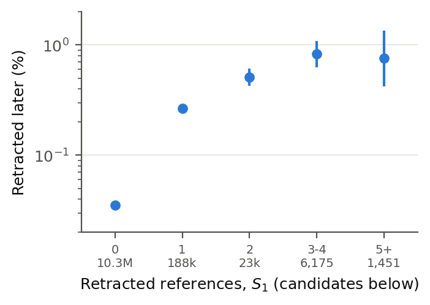
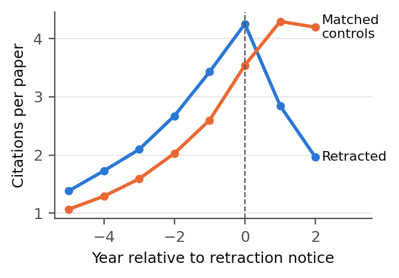
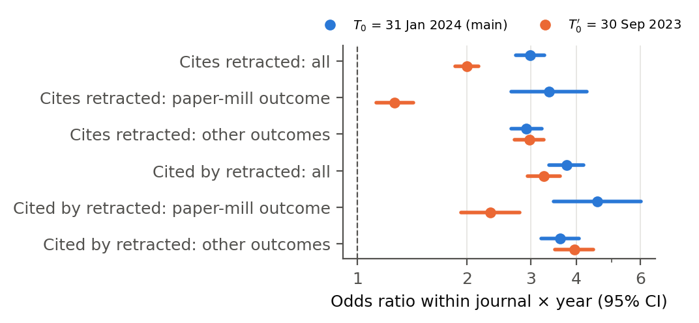
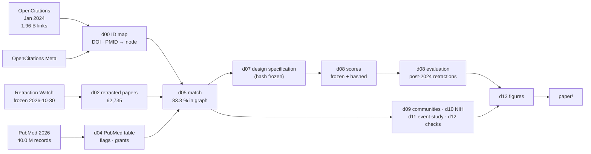

<h1 align="center">🔗 Retracted neighbours and future retractions</h1>

<p align="center">
  <em>Do links to retracted papers predict future retractions? An out-of-sample test on the open biomedical citation graph</em>
</p>

<p align="center">
  
  
  
  
  
</p>

Companion repository to the paper by **Hossein Mohasel Arjomandi** (manuscript submitted for publication). It holds
the code, the design specification, every run record with checksums, a map from each number in the paper to the run that
produced it, and the LaTeX source.

---

## 🧭 In one paragraph

Integrity tools flag papers that cite retracted work, and a retrospective study found that such papers are retracted
more often. This project asks whether the signal works **prospectively**, the way a screening tool is used. Scores are
computed on the **January 2024** OpenCitations graph, using only the retractions known by then, **frozen with a hash**,
and then compared with retractions issued from **February 2024 to October 2026** (Retraction Watch). The design, scores,
metrics and decision rule were specified in advance, in a file whose hash was logged before any score was computed.

## 📊 Results at a glance

| | |
|---|---|
| Papers tested (biomedical, published 2015–2023) | **10,495,850** |
| Retracted later (Feb 2024 – Oct 2026) | **4,323** (0.041%) |
| Already citing a retracted paper in Jan 2024 | 218,561 (2.1%) |
| Later retraction rate with 0 / 1 / 2 / 3–4 retracted references | 0.035% / 0.27% / 0.51% / 0.83% |
| **Odds ratio within journal × year** (the pre-specified test) | **2.99** (95% CI 2.73–3.27) ✅ signal holds |
| … also holding reference-list length fixed (post hoc) | 3.03 (2.76–3.33) |
| Research articles with ≥5 retracted references retracted later (reviews excluded, post hoc) | 2.27% (10 of 441) |
| As a screen: share of the top 1,000 flagged papers retracted later | 0.9% (22 × the base rate) |
| … with reviews set aside (post hoc) | 2.2% (52 × the base rate) |
| Later retractions that cite no retracted paper at all | 84% |
| Inside the late-2023 retraction wave: the journal's own rate as a screen | 6.8% of its top 1,000 (lift 94) |
| Paper-mill retractions cluster in citation communities (vs matched controls) | 1.68× / 1.52× (two Leiden seeds) |
| NIH-funded vs other papers citing already-retracted work (same journal × year) | odds ratio 1.03 (1.00–1.05) |

**Take-away:** links to retracted papers are a real warning sign, not just a journal effect, but a weak screen on their
own. Every number above is traced in [`FINDINGS.md`](FINDINGS.md).

<p align="center">
  
  &nbsp;
  
</p>
<p align="center">
  
</p>

## 🗂️ What is in here

```text
.
├── README.md            ← you are here
├── FINDINGS.md          every number in the paper → the run that produced it
├── REPRODUCE.md         inputs + checksums, environment, exact commands in order, determinism notes
├── CITATION.cff         how to cite this repository
├── experiments/
│   ├── README.md        index of steps and the runs cited in the paper
│   ├── d07_prereg/      PREREGISTRATION.md: the design specification (SHA-256 logged before any score existed)
│   ├── d00 … d14/       one folder per step: script(s), lab notebook RESULTS_LOG.md, runs/<run_id>/
│   └── …/runs/<id>/     run.json (parameters, script hash, counts) · stdout.log · outputs · SHA256SUMS
├── paper/               LaTeX source (content/, main.tex), figures, refs.bib + DOI checks, main.pdf
├── lit/LIT.md           literature search records and the gap statement
└── vm/                  scripts and environment for the large-machine steps
```

## 🔁 How the pipeline fits together



## ⚡ Quick start

**On a laptop (minutes, no large data):**

```bash
pip install duckdb pandas pyarrow lxml matplotlib     # or: micromamba create -n d -f vm/environment_d.lock.yml

# 1. verify every run record against its checksums
ok=1; for d in experiments/*/runs/*/; do [ -f "$d/SHA256SUMS" ] || continue   # stopped runs have none
  (cd "$d" && sha256sum -c --quiet SHA256SUMS) || ok=0; done; [ $ok = 1 ] && echo "all runs OK"

# 2. unit test of the PubMed parser
cd experiments/d04_pubmed && python test_pubmed_parse.py && cd -

# 3. rebuild the paper's figures from the run records (byte-identical to the committed ones)
cd experiments/d13_figures && python d13_figures.py my_rebuild && cd -
git status --short paper/figures                        # nothing listed = identical

# 4. build the paper (Tectonic or any XeLaTeX)
cd paper && tectonic -X compile main.tex
```

**Full pipeline:** about 64 GB RAM, 150 GB disk and about two machine-hours. Download the public inputs, then
run the steps in [`REPRODUCE.md`](REPRODUCE.md) §3 in order.

## 📥 Data sources

| Source | Used for | Access | Terms |
|---|---|---|---|
| Parsed OpenCitations snapshot, Jan 2024 | citation graph | Illinois Data Bank, [doi:10.13012/B2IDB-5216575_V1](https://doi.org/10.13012/B2IDB-5216575_V1) | CC BY 4.0 |
| OpenCitations Meta | DOIs, PMIDs, journals | figshare, [doi:10.6084/m9.figshare.21747461.v7](https://doi.org/10.6084/m9.figshare.21747461.v7) | CC0 |
| Retraction Watch database | retraction labels, dates, reasons | [gitlab.com/crossref/retraction-watch-data](https://gitlab.com/crossref/retraction-watch-data), commit `a98cc7e` | CC0 per Crossref's licence table; Crossref asks published work to cite the source |
| PubMed 2026 baseline | retraction flags, NIH grants | [NLM baseline files](https://ftp.ncbi.nlm.nih.gov/pubmed/baseline/) | courtesy of the U.S. National Library of Medicine |

The inputs are large and are not redistributed here. The derived dataset (all 62,735 retracted papers with their
retraction dates and reasons, the 2.26 million citation links that touch them, and the community memberships) is on
Zenodo: [doi:10.5281/zenodo.23874477](https://doi.org/10.5281/zenodo.23874477).

## 🔒 Rigour by design

- **Pre-specified.** [`PREREGISTRATION.md`](experiments/d07_prereg/PREREGISTRATION.md) fixed the scores, metrics,
  sensitivity analyses and the decision rule; its SHA-256 was logged before any score was computed. It was not
  deposited with a third-party registry before the outcomes were read, so it is a pre-specification, not a formal
  pre-registration (the file name is historical). Analyses added later are in `experiments/d15_review1/`, labelled post hoc.
- **Frozen scores.** The evaluation script checks the hashes of the frozen score files before it reads any outcome.
- **Deterministic.** Fixed seeds, rows sorted before tie-breaks and resampling, controls chosen by a fixed hash; a
  repeat of the event study is byte-identical, and so are rebuilt figures.
- **Nothing overwritten.** Every run gets its own folder; replaced runs keep a `SUPERSEDED.txt` explaining why.
- **Verified references.** Every reference was resolved through its DOI
  ([`paper/bib_verification.tsv`](paper/bib_verification.tsv)).

## 🤝 Responsible use

- No author names, and **no score, rank or list of non-retracted papers**. A flag is a reason to look, not evidence of a
  problem: many papers cite retracted work for good reasons (reviews, critiques, citations made before the retraction).
- A retraction is a public editorial label; it does not by itself imply misconduct.
- All results are associations.

## 📝 Citation

Please cite the paper (details will be added on publication) and this repository; GitHub's *Cite this repository*
button uses [`CITATION.cff`](CITATION.cff).

## ⚖️ Licences

Code: [MIT](LICENSE). Run records, tables, figures and documentation: [CC BY 4.0](LICENSE-DATA). The input datasets
keep their own terms.

## 🤖 Generative AI

Claude Opus 5.5 (Anthropic) was used as a coding and writing assistant under the author's direction. The author
checked every analysis, number and reference.
